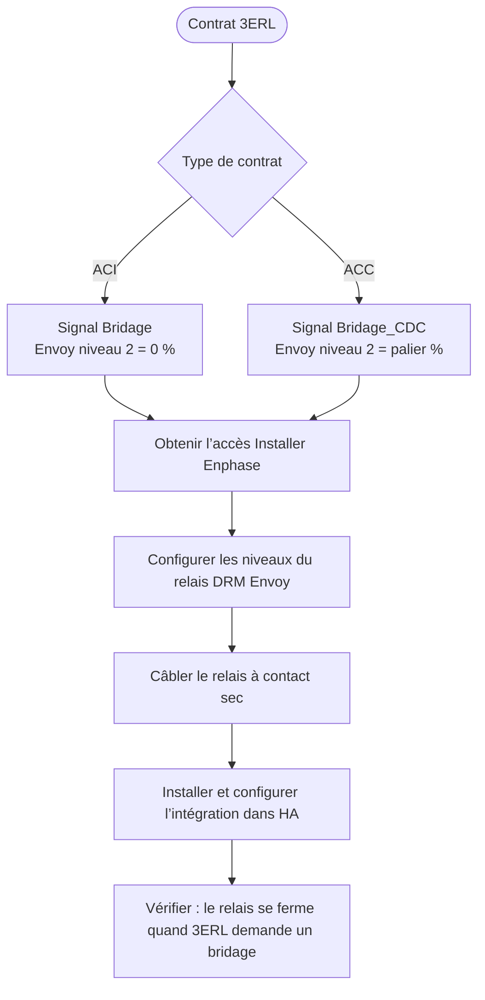
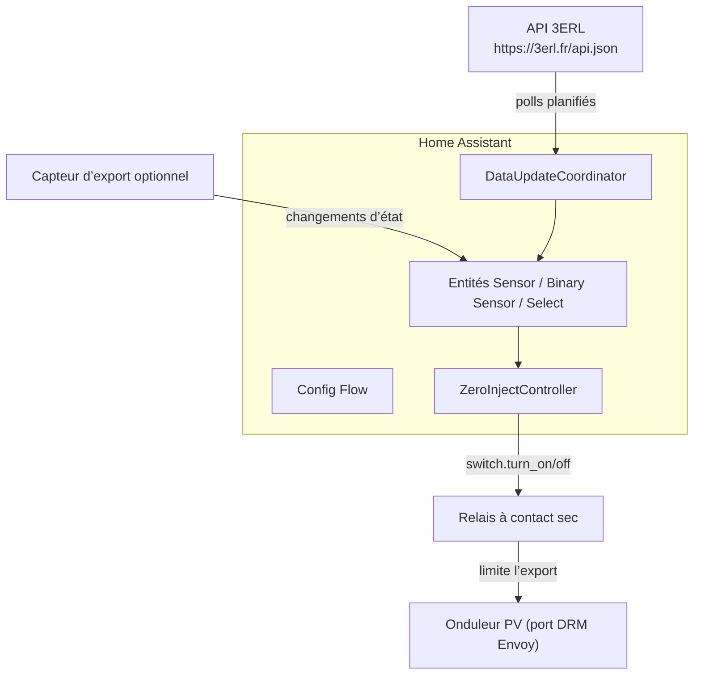
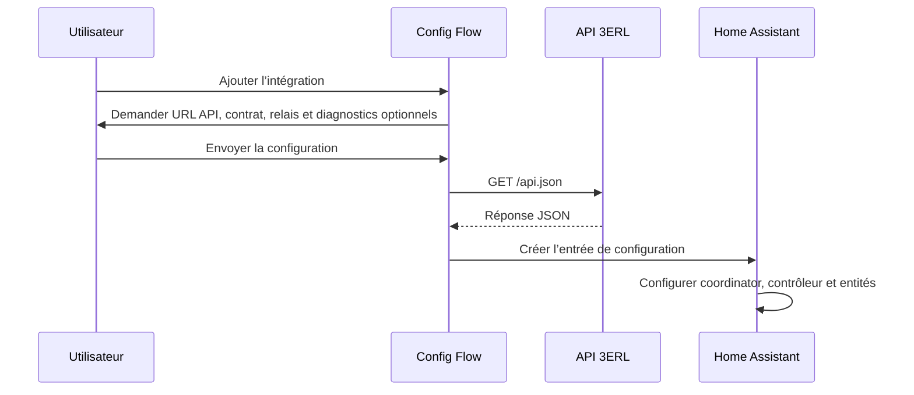
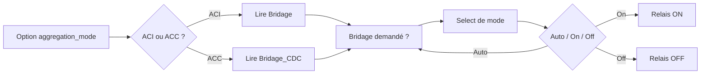
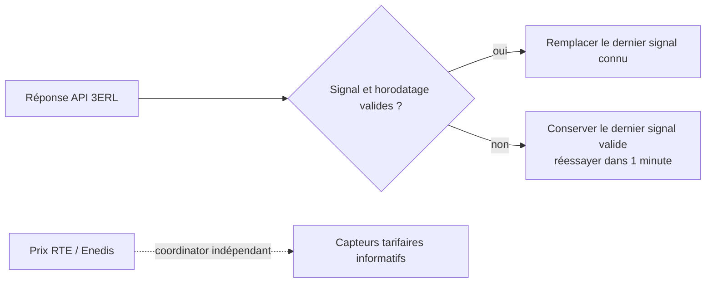

# Workflow 3ERL Zero-Injection

Ce document décrit l’architecture, le flux de données et le fonctionnement de l’intégration.

## Mise en place de bout en bout



## Vue d’architecture



## Flux de configuration



## Sélection du signal

Le type de contrat choisit le champ API qui pilote le relais.



## Machine d’état zéro-injection

Le contrôleur réévalue à chaque mise à jour du coordinator et à chaque changement du select, du bypass ou d’un relais. Il compare l’état calculé à l’état rapporté par le relais. Il n’envoie rien tant que le relais est indisponible et le réaligne dès son retour avec la commande courante. Il n’existe pas de minuteur de retry dédié d’une minute. Les notifications décrivent les transitions de commande, pas l’acquittement ni l’effet mesuré, et ne sont pas envoyées au démarrage.

Le bypass manuel prime sur Auto/On/Off et suspend toutes les commandes. Il persiste après rechargement et redémarrage. Sa désactivation reprend le mode sélectionné et peut basculer le relais immédiatement. Avant la première réponse API valide, Auto laisse les relais inchangés ; les modes forcés et le bypass restent utilisables. Une panne API ne décharge pas les contrôles locaux. Après une réponse valide, Auto conserve le dernier signal connu pendant la panne, sauf si le bypass est actif.

`ThreeERLSupervisionSensor` écoute indépendamment les relais, le mode, le bypass, les mesures d’export, le coordinator et un minuteur de cinq secondes. Il signale immédiatement les relais indisponibles et les désaccords après 30 secondes. Un export au-dessus du seuil pendant une limitation commandée doit persister pendant la durée configurée. Une mesure absente, périmée, négative, non finie ou d’unité non prise en charge produit `unknown`. Le minuteur supervise les diagnostics uniquement ; il n’envoie ni commande relais ni requête réseau.

La visibilité par contrat utilise le registre d’entités et conserve les choix explicites de l’utilisateur. L’entité de commande active s’appelle `commanded_limitation` ; les switchs d’origine fournissent les états relais et le diagnostic d’export fournit une observation séparée.

```mermaid
stateDiagram-v2
    [*] --> Inactive

    state Inactive {
        [*] --> choose
        state choose <<choice>>
        choose --> Active: mode = On ou (mode = Auto et signal = 1)
        choose --> Inactive: mode = Off ou (mode = Auto et signal = 0)
    }

    state Active {
        [*] --> choose2
        state choose2 <<choice>>
        choose2 --> Inactive: mode = Off ou (mode = Auto et signal = 0)
        choose2 --> Active: mode = On ou (mode = Auto et signal = 1)
    }

    Inactive --> Active
    Active --> Inactive
```

## Validation du signal et prix



Un champ de bridage invalide, absent ou mal formé est traité comme une erreur de source, pas comme « pas de bridage ». Un `Heure_Update` futur est rejeté et réessayé rapidement au lieu de retarder le polling selon sa date littérale.

La rémunération estimée et l’énergie bridée sont hors périmètre : 3ERL publie la rémunération sur <https://dashboard.3erl.fr>, et un capteur de puissance ne peut pas mesurer la production contrefactuelle qui aurait eu lieu sans limitation.

## Workflow opérationnel

1. L’utilisateur installe l’intégration via HACS ou copie manuelle, puis la configure dans l’interface Home Assistant.
2. Le coordinator de signal interroge l’API selon le calendrier publié : environ 18 minutes après chaque `Heure_Update`, puis toutes les minutes si les données fraîches sont en retard ou invalides.
3. Le contrôleur écoute les mises à jour du coordinator, le select et les relais, puis aligne les relais sur l’état calculé.
4. Le coordinator tarifaire rafraîchit RTE et Enedis indépendamment ; ses échecs ne retardent pas le contrôle.
5. Le select restaure sa dernière valeur après rechargement ou redémarrage.

## Maintenance

- Pour modifier les relais, le contrat, le diagnostic d’export ou les notifications : **Paramètres → Appareils et services → 3ERL Zero-Injection → Configurer**.
- Pour comparer les prix à la santé du contrôle, utilisez les capteurs API et les entités PRE+ courant/estimé.
