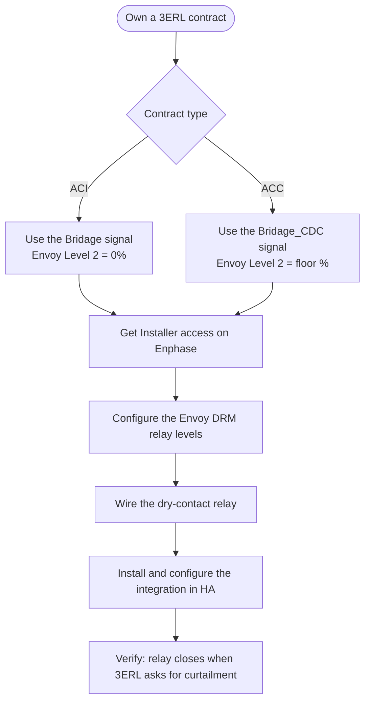
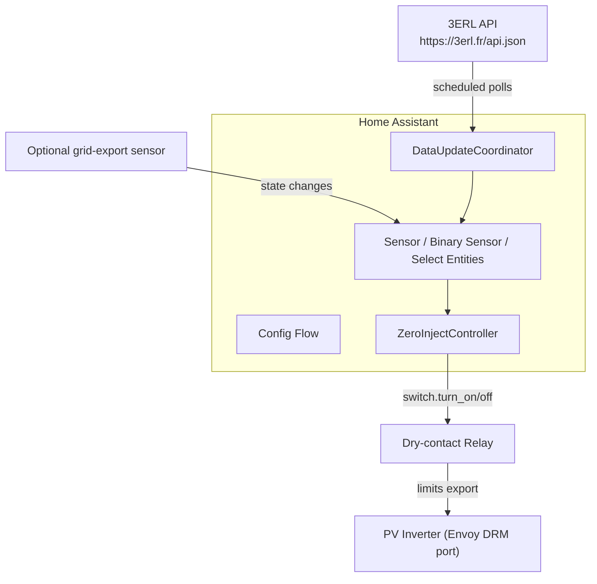
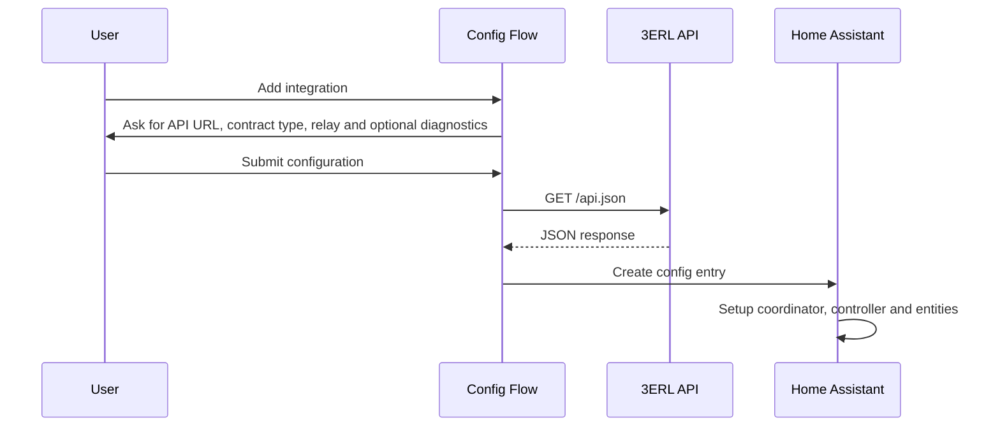
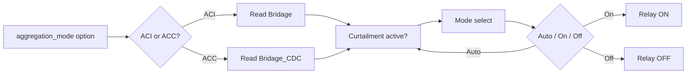
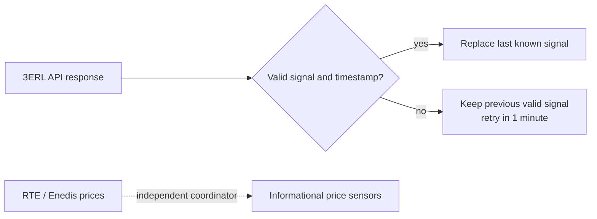

# 3ERL Zero-Injection workflow

This document describes the architecture, data flow and operational workflow of the 3ERL Zero-Injection integration.

## End-to-end setup



## Architecture overview



## Configuration flow



## Signal selection

The configured contract type selects the API field that drives the relay.



## Zero-injection state machine

The controller re-evaluates on every coordinator update and whenever the mode select, bypass switch or a relay changes. It compares the computed state with the reported relay state. It sends nothing while the relay is unavailable and realigns it as soon as it returns, using the current command. There is no dedicated one-minute command retry timer. Notifications describe command transitions, not relay acknowledgement or measured effects, and are not sent at startup.

Manual bypass takes precedence over Auto/On/Off and suspends all relay commands. It persists across reloads and restarts. Disabling it resumes the selected mode, potentially switching the relay immediately. Before a first successful API response, Auto leaves relays unchanged; forced modes and bypass remain usable. API failures do not unload these local controls. After a successful response, Auto continues to use the last known signal during an outage, unless bypass is enabled.

`ThreeERLSupervisionSensor` independently listens to relay, mode, bypass and export-measurement changes, coordinator updates, and a five-second local timer. It reports unavailable relays immediately and mismatches after 30 seconds. Grid export above the configured threshold during commanded limitation must persist for the configured confirmation duration. Missing, stale, negative, non-finite or unsupported measurements are unknown. The timer supervises diagnostics only; it does not issue relay commands or network requests.

Contract visibility uses entity-registry APIs and per-entity options to preserve explicit user overrides. The commanded-limitation entity uses a new entity ID and unique ID suffix, and the estimated-remuneration sensors were removed. This is a breaking development change without legacy entity migration; consumers must use the new identifiers. The active entity is now named commanded limitation; the original switches supply relay state, and the optional export diagnostic supplies a separate observation.

```mermaid
stateDiagram-v2
    [*] --> Inactive

    state Inactive {
        [*] --> choose
        state choose <<choice>>
        choose --> Active: mode = On or (mode = Auto and signal = 1)
        choose --> Inactive: mode = Off or (mode = Auto and signal = 0)
    }

    state Active {
        [*] --> choose2
        state choose2 <<choice>>
        choose2 --> Inactive: mode = Off or (mode = Auto and signal = 0)
        choose2 --> Active: mode = On or (mode = Auto and signal = 1)
    }

    Inactive --> Active
    Active --> Inactive
```

## Signal validation and pricing



Invalid, missing or malformed curtailment fields are treated as a source error, not as "no curtailment". A future `Heure_Update` is rejected and retried shortly instead of delaying polling by its literal date.

Estimated remuneration and curtailed energy are out of scope: 3ERL publishes remuneration on <https://dashboard.3erl.fr>, and a power sensor cannot measure the counterfactual production that would have occurred without limitation.

## Operational workflow

1. The user installs the integration via HACS or manual copy, then configures it through the Home Assistant UI.
2. The signal coordinator fetches the 3ERL API on the published update schedule: about 18 minutes after each `Heure_Update`, with a 1-minute retry when fresh data is late or invalid.
3. The controller listens to coordinator updates, mode-select changes and relay changes, then aligns the relay with the computed state.
4. The pricing coordinator refreshes RTE and Enedis data independently; its failures do not delay relay control.
5. The mode select restores its last value after a restart or reload.

## Maintenance workflow

- To change the relay, contract type, export diagnostic or notification entities, use **Settings → Devices & services → 3ERL Zero-Injection → Configure**.
- To inspect price data separately from control health, compare the API sensors with the current and estimated PRE+ entities.
