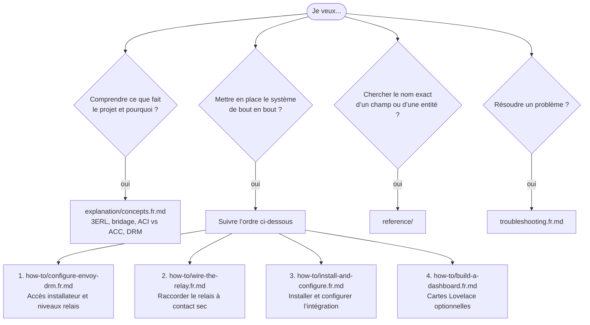

# Documentation

Cette documentation suit la structure [Diátaxis](https://diataxis.fr/). Choisissez la page qui correspond à votre besoin actuel.

| Besoin | Page |
|---|---|
| Comprendre 3ERL, le bridage, ACI vs ACC et comment le relais arrête l’export | [explanation/concepts.fr.md](explanation/concepts.fr.md) |
| Comprendre le calcul du prix journalier de rémunération (PRE+) | [explanation/daily-prep-estimate.fr.md](explanation/daily-prep-estimate.fr.md) |
| Obtenir l’accès Installateur Enphase et configurer les niveaux du relais DRM | [how-to/configure-envoy-drm.fr.md](how-to/configure-envoy-drm.fr.md) |
| Raccorder un relais à contact sec au port DRM de l’Envoy | [how-to/wire-the-relay.fr.md](how-to/wire-the-relay.fr.md) |
| Installer et configurer l’intégration dans Home Assistant | [how-to/install-and-configure.fr.md](how-to/install-and-configure.fr.md) |
| Ajouter des cartes au tableau de bord | [how-to/build-a-dashboard.fr.md](how-to/build-a-dashboard.fr.md) |
| Importer une vue de tableau de bord prête à l’emploi | [examples/view.yaml](examples/view.yaml) |
| Consulter les champs de configuration | [reference/configuration-options.fr.md](reference/configuration-options.fr.md) |
| Consulter les entités créées | [reference/entities.fr.md](reference/entities.fr.md) |
| Consulter les champs de l’API 3ERL | [reference/api-fields.fr.md](reference/api-fields.fr.md) |
| Vérifier si des services personnalisés existent | [reference/services.fr.md](reference/services.fr.md) |
| Diagnostiquer un problème | [troubleshooting.fr.md](troubleshooting.fr.md) |
| Comprendre l’architecture interne | [../WORKFLOW.fr.md](../WORKFLOW.fr.md) |
