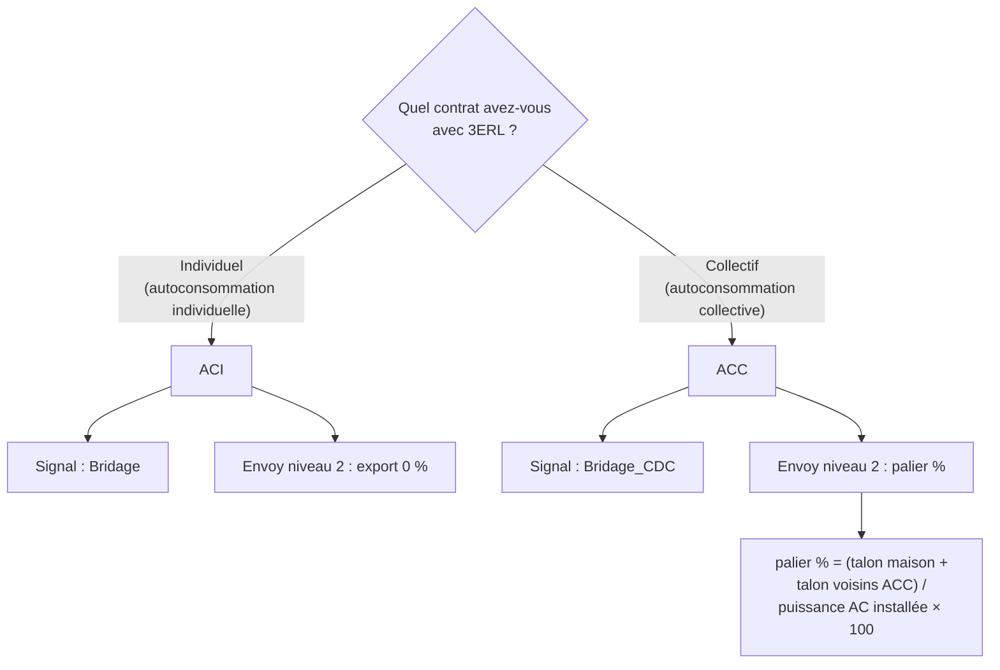

# Fonctionnement du zéro-injection 3ERL

Cette page explique les concepts de l’intégration. Pour installer le système, commencez par les [guides pratiques](../README.fr.md).

## 3ERL et le bridage

[3ERL](https://3erl.fr) est une association française qui agit comme responsable d’équilibre. Elle permet aux autoconsommateurs de vendre leur surplus solaire au prix de marché plutôt qu’à un tarif fixe. Lorsque les prix deviennent négatifs, injecter de l’énergie coûte de l’argent au lieu d’en rapporter ; 3ERL demande alors à ses membres d’arrêter l’injection.

L’association publie une API publique sur `https://3erl.fr/api.json`, rafraîchie aux minutes 3, 18, 33 et 48 de chaque heure. Deux champs portent le signal de bridage :

- `Bridage` pour les contrats individuels (ACI) ;
- `Bridage_CDC` pour les contrats collectifs (ACC).

L’intégration interroge cette API et commande un relais à contact sec raccordé à l’onduleur. Quand le signal demande un bridage, le relais se ferme et l’onduleur limite son export.

## ACI vs ACC

Le type de contrat détermine le champ suivi et le comportement attendu de l’onduleur.

Pourquoi cette différence :

- En **ACI**, le surplus est valorisé à la moyenne journalière pondérée (`PRD4`). Si cette moyenne devient négative, chaque kilowatt-heure injecté dans la journée est facturé à prix négatif. La coupure complète de l’export est la bonne réponse.
- En **ACC**, le surplus est valorisé au PRE+ quart-horaire et le dispositif collectif conserve une injection résiduelle — le « talon » — pour couvrir la consommation de base des membres. Le niveau 2 de l’Envoy doit laisser ce pourcentage au lieu de couper à zéro.

Sélectionnez la valeur correspondante dans l’option **Type de contrat d’autoconsommation**.

## Le port DRM

Les passerelles Enphase Envoy exposent une entrée numérique qui limite la production lorsque son contact se ferme. Le projet de référence l’appelle port DRM. L’Envoy applique un niveau d’export configuré selon l’état du relais :

| État du contact | Niveau Envoy | Export |
|---|---|---|
| Ouvert | Niveau 1 | 100 % |
| Fermé | Niveau 2 | 0 % (ACI) ou palier configuré (ACC) |

Ce montage ne revient à l’export normal que si le relais ouvre physiquement son contact. Un réglage comme `power_on_behavior: off` ne prouve pas à lui seul le comportement après une perte Zigbee, un arrêt de Home Assistant ou une panne du coordinateur. Vérifiez le comportement réel de votre modèle avant de vous y fier.

## Rémunération et énergie bridée

3ERL rémunère 70 % du prix de règlement positif des écarts (PRE+) lorsque les prix sont positifs. Les 30 % restants couvrent les coûts de fonctionnement de l’association. L’intégration ne calcule pas cette rémunération : 3ERL publie les montants estimés et réglés sur <https://dashboard.3erl.fr>.

L’intégration expose néanmoins les prix sous forme de capteurs informatifs : le PRE+ quart-horaire courant (ACC) et un PRE+ journalier estimé pondéré par le profil PRD3 Enedis (ACI). Comme Enedis publie le profil PRD3 du jour seulement après coup, l’estimation utilise par défaut le profil d’un jour passé (`-2`). Voir [Calcul du PRE+ journalier](daily-prep-estimate.fr.md).

L’intégration ne mesure ni n’estime l’énergie bridée. La production perdue est contrefactuelle : pendant la limitation, un capteur de production mesure la puissance déjà réduite, pas celle que l’onduleur aurait pu produire sans la limitation. Un capteur d’export réseau ne peut pas non plus fournir cette valeur.

## Pages liées

- [Référence des champs API](../reference/api-fields.fr.md)
- [Configurer le port DRM Envoy](../how-to/configure-envoy-drm.fr.md)
- [Installer et configurer l’intégration](../how-to/install-and-configure.fr.md)
