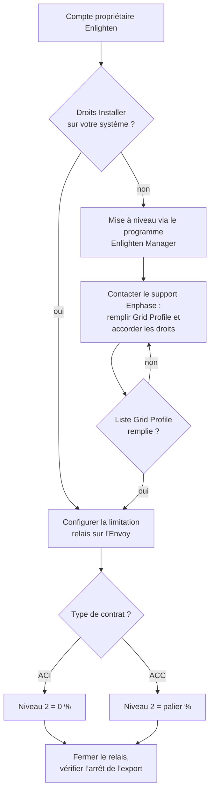

# Configurer le port DRM de l’Envoy

Objectif : obtenir un accès de niveau Installateur sur votre système Enphase et configurer le port relais afin qu’un contact fermé limite l’export.

## Vue d’ensemble



## Prérequis

- Un Envoy-S ou IQ Gateway avec bornier DRM physique.
- Un navigateur web.
- Un accès Installer à l’Envoy. Un compte Propriétaire standard n’expose pas les réglages nécessaires.

## Étape 1 : obtenir l’accès Installer

Le chemin le plus simple pour un propriétaire est le **Enlighten Manager Upgrade Program**. Votre compte Propriétaire existant fonctionne sur cette page.

1. Ouvrez le [Enlighten Manager Upgrade Program](https://encare.enphase.com/?upgradeProgramType=1).
2. Choisissez une formule :
   - **Monthly Subscription**, 9,99 €/mois ;
   - **Lifetime Subscription**, 249 € une fois.
3. Finalisez l’achat, puis déconnectez-vous et reconnectez-vous à Enlighten.

Il s’agit d’un service payant tiers. Les prix et la disponibilité dépendent de votre région et peuvent changer. Cette intégration n’est pas affiliée à Enphase.

## Étape 2 : demander au support Enphase de débloquer le système

La mise à niveau seule peut ne pas suffire. Un utilisateur a rapporté qu’après l’achat, la page **Grid Profile** était modifiable mais que la liste des profils restait vide. Le support Enphase a corrigé cela pendant un appel téléphonique.

Contactez le [support Enphase](https://enphase.com/fr-fr/contact-enphase-support) et demandez :

- des droits de niveau Installer sur votre propre système ;
- que le paramètre **Grid Profile** soit disponible **et** rempli avec des profils sélectionnables.

## Étape 3 : configurer la limitation par relais

Chemin dans l’interface Envoy : **Devices → Gateway → Limit production via relay on digital input port** — interface française : **Appareils → Passerelle → Limiter la production via relais sur Port d’entrée numérique**.

| Champ | Valeur |
|---|---|
| Limitation target | **Export** |
| Reference value | Puissance AC installée [W] |
| Maximum capacity | Puissance AC installée en W, voir ci-dessous |
| Number of relay parameters | 4 |
| Number of levels to set | 2 |
| Default limitation | 100 % |
| Sweep speed | 1000 W/sec |

### Calculer la puissance AC installée

Utilisez la puissance AC **continue** maximale de chaque micro-onduleur, pas la valeur crête en VA :

```text
puissance_AC_installée (W) = nombre_de_panneaux × puissance_AC_continue_micro_onduleur (W)
```

Exemple — 24 panneaux avec un IQ8PLUS chacun :

```text
24 × 290 W = 6 960 W  →  saisir 6960 dans "Maximum capacity"
```

La fiche IQ8PLUS indique 290 W en continu et 300 VA en crête. Vingt-quatre unités culminent à 7 200 W, mais la valeur continue est la bonne référence.

### Régler les niveaux du relais

L’intégration pilote **Relay 1**, câblé entre `Com` et `1/5` sur le port DRM.

| Niveau | Relay 1 | Relay 2–4 | Limite d’export |
|---|---|---|---|
| Niveau 1 — normal | 0 | 0 | 100 % |
| Niveau 2 — **ACI** | 1 | 0 | **0 %** |
| Niveau 2 — **ACC** | 1 | 0 | **palier %**, voir ci-dessous |

En **ACC**, calculez le palier résiduel puis arrondissez au pourcentage entier supérieur :

```text
Niveau 2 (%) = (talon_maison_W + talon_voisins_ACC_W) / puissance_AC_installée_W × 100
```

Exemple avec le système 24 × IQ8PLUS, un talon maison de 200 W et 500 W pour les voisins ACC : (200 + 500) / 6960 × 100 ≈ 10,06 % → **11 %**.

En ACI, le niveau 2 reste à 0 % ; la puissance installée sert seulement de référence au réglage. Voir [ACI vs ACC](../explanation/concepts.fr.md#aci-vs-acc) pour le raisonnement, puis configurez le même **type de contrat d’autoconsommation** dans les options.

## Étape 4 : vérifier

1. Dans l’interface web Envoy, consultez les valeurs de production et d’export en direct.
2. Fermez le relais. Si l’intégration est installée, passez le mode sur **On** ; sinon activez le switch relais manuellement.
3. L’export doit descendre à zéro en ACI, ou au palier configuré en ACC, en quelques secondes.
4. Ouvrez le relais. L’export doit reprendre après un court délai.

Si l’export ne descend pas, consultez la page de [dépannage](../troubleshooting.fr.md#lexport-nest-pas-limité-alors-que-le-relais-est-actif).

## Références

- [Enphase Enlighten](https://enlighten.enphaseenergy.com)
- [Manuel d’installation et d’exploitation Envoy-S (PDF)](../assets/enphase/EnvoySMultiphase-IOM-FR.pdf)
- [Guide d’installation rapide Envoy-S (PDF)](../assets/enphase/Envoy-S-M-QIG-Multi-Kit-Rev05-FR-2024-01-05.pdf)
- [Manuel de référence Envoy-S (PDF)](../assets/enphase/Envoy-S-MAN-EN-INTL_FR.pdf)
- [Automatisation-Bridage-3ERL-Emphase](https://github.com/ALP40/Automatisation-Bridage-3ERL-Emphase)
