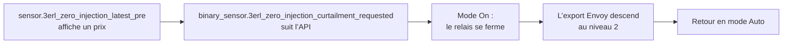

# Installer et configurer l’intégration

Objectif : installer `zero_inject_3erl` dans Home Assistant et le connecter à votre relais.

## Prérequis

- Home Assistant 2026.9.3 ou plus récent.
- Une entité `switch.*` pour le relais à contact sec, déjà appairée et câblée. Voir [Câbler le relais](wire-the-relay.fr.md).
- Le port DRM de l’Envoy configuré. Voir [Configurer le port DRM de l’Envoy](configure-envoy-drm.fr.md).
- Optionnel : un capteur d’export réseau positif en W/kW ou VA/kVA pour le diagnostic d’export.

## Installer

### HACS (recommandé)

1. Ajoutez `gounick/ha-zero-inject-3erl` comme dépôt personnalisé dans HACS et installez **3ERL Zero-Injection**.
2. Redémarrez Home Assistant.

### Manuel

1. Copiez `custom_components/zero_inject_3erl` dans `config/custom_components`.
2. Redémarrez Home Assistant.

## Configurer

1. Allez dans **Paramètres → Appareils et services → Ajouter une intégration** et recherchez **3ERL Zero-Injection**.
2. Remplissez le formulaire :

   | Champ | Que saisir |
   |---|---|
   | URL de l’API 3ERL | Gardez la valeur `https://3erl.fr/api.json`. |
   | Type de contrat d’autoconsommation | `aci` utilise `Bridage`, `acc` utilise `Bridage_CDC`. Voir [ACI vs ACC](../explanation/concepts.fr.md#aci-vs-acc). |
   | Interrupteurs des relais | L’entité `switch.*` de votre relais ; sélectionnez-en plusieurs si chaque source de production possède son relais. |
   | Capteur d’export réseau | Mesure positive d’export, utilisée seulement pour l’observation. |
   | Entités de notification | Entités `notify.*` optionnelles pour les changements de commande. |
   | Décalage du profil PRD3 | Gardez `-2`, sauf raison particulière. Voir [estimation PRE+ journalière](../explanation/daily-prep-estimate.fr.md). |

3. Validez. L’intégration vérifie l’API puis crée les entités décrites dans la [référence des entités](../reference/entities.fr.md).

Tous les champs restent modifiables sous **Paramètres → Appareils et services → 3ERL Zero-Injection → Configurer**. La liste complète est dans les [options de configuration](../reference/configuration-options.fr.md).

## Vérifier

1. Vérifiez que `sensor.3erl_zero_injection_latest_pre` affiche une valeur après le premier poll.
2. Passez le mode sur **On** : le relais se ferme et l’export s’arrête ou descend au palier ACC.
3. Revenez en **Auto** : le relais suit le signal 3ERL courant. Il ne s’ouvre que si aucun bridage n’est demandé ; utilisez le bypass manuel pour piloter le relais directement.

En cas d’échec, consultez le [dépannage](../troubleshooting.fr.md).
