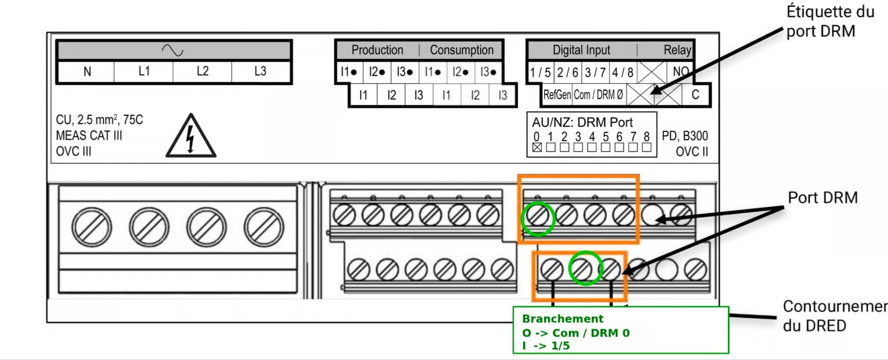
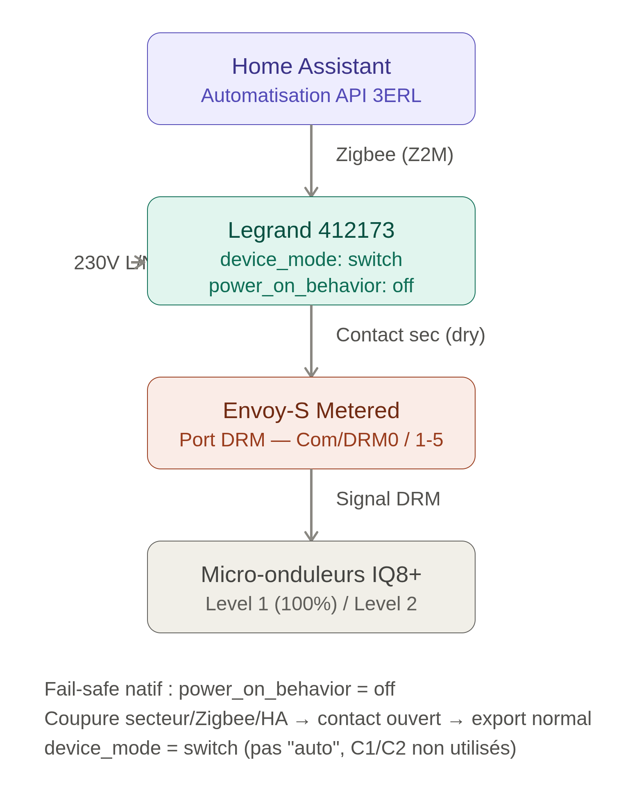
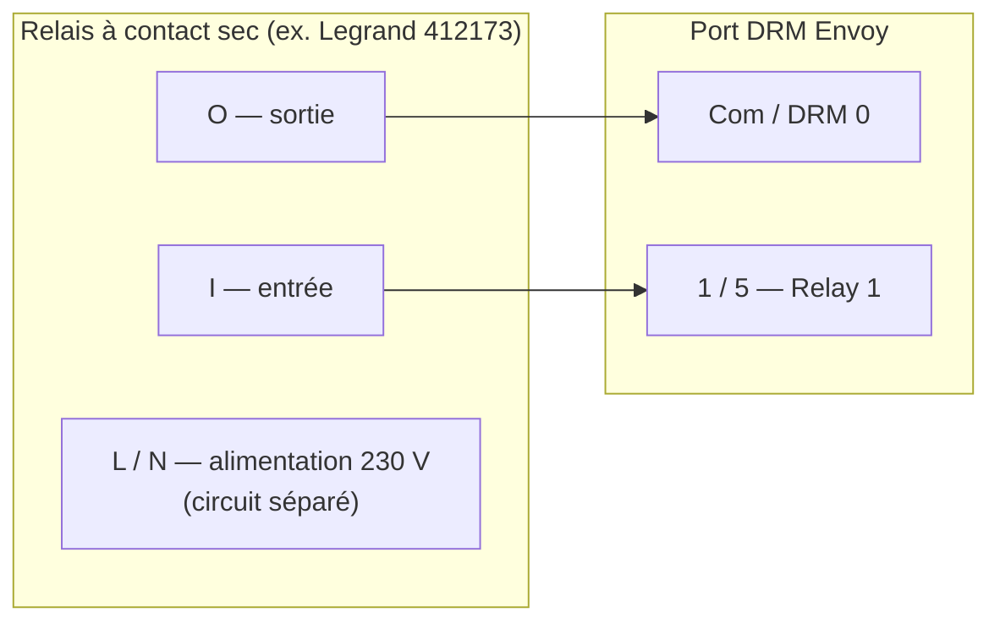
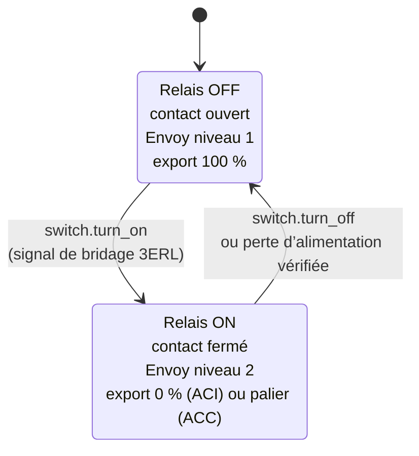

# Câbler un relais à contact sec au port DRM de l’Envoy

Objectif : raccorder un relais de sorte que la fermeture de son contact demande à l’Envoy de limiter l’export.

## Avertissement

Les travaux électriques doivent être réalisés par une personne qualifiée. Coupez l’onduleur et les disjoncteurs AC avant d’ouvrir un coffret. L’auteur et les contributeurs ne sont pas responsables des dommages ou blessures.

## Matériel requis

- Envoy-S ou IQ Gateway Enphase avec port DRM, déjà configuré selon [Configurer le port DRM Envoy](configure-envoy-drm.fr.md).
- Un **relais à contact sec** pilotable depuis Home Assistant, par exemple un relais Zigbee ou équivalent.
  - Liste non exhaustive :
    - [Legrand 412173](https://www.zigbee2mqtt.io/devices/412173.html)
    - [ADEO SIN-4-1-20_EQU](https://www.zigbee2mqtt.io/devices/SIN-4-1-20_EQU.html)
    - [certains appareils Shelly](https://www.shelly.com/fr/collections/smart-switches-dimmers?filter.p.m.custom.filter_product_type_2=gid%3A%2F%2Fshopify%2FMetaobject%2F495237431645&filter.p.m.custom.filter_inputs_2=gid%3A%2F%2Fshopify%2FMetaobject%2F495629107549&filter.p.m.custom.filter_outputs_2=gid%3A%2F%2Fshopify%2FMetaobject%2F495652995421)
- Câble basse tension adapté, paire torsadée ou câble blindé selon la distance.
- Pour un relais Zigbee, un coordinateur compatible Home Assistant : ZHA, Zigbee2MQTT ou deCONZ.

## Repérer le port DRM

Sur l’**Envoy-S Metered**, le port DRM est le petit bornier situé au-dessus des bornes principales. Repérez les mentions **Com / DRM 0** et **1 / 5**.

## Câbler le relais

Le contact sec du relais se place entre les bornes `Com` et `1/5`. Ce sont des entrées numériques basse tension : ne leur connectez jamais du 230 V.

Avec un Legrand 412173 :

- **O (sortie)** → `Com / DRM 0` ;
- **I (entrée)** → `1 / 5` — cette paire correspond à Relay 1 dans la configuration Envoy ;
- les entrées auxiliaires C1/C2 ne sont pas utilisées ;
- alimentez le relais sur un circuit 230 V séparé, sans prendre d’énergie sur le port DRM.

Pour les autres modèles, raccordez de la même façon les deux extrémités du contact isolé à `Com` et `1/5`.

Remarques câble :

- gardez la liaison courte ; pour les longues distances, utilisez une paire torsadée blindée et mettez le blindage à la terre d’un seul côté ;
- ne raccordez jamais les bornes d’alimentation du relais au port DRM.

## Vérifier le comportement en cas de panne

Pour une installation fail-open, le contact doit physiquement s’ouvrir quand le relais perd son alimentation. Les autres pannes dépendent du modèle : une perte du réseau Zigbee ou un redémarrage de Home Assistant peut laisser un relais alimenté dans son dernier état. Ne vous fiez pas uniquement à `power_on_behavior` pour démontrer ces cas.

Sur le Legrand 412173, réglez :

- `device_mode` sur **switch**, pas « auto » ;
- `power_on_behavior` sur **off**, afin que le contact s’ouvre après une perte d’alimentation.

Testez votre modèle en arrêtant Home Assistant puis en coupant la communication Zigbee pendant que le contact est fermé. S’il reste fermé alors qu’un comportement fail-open est nécessaire, ajoutez un watchdog matériel ou choisissez un relais documentant ce comportement.

## Appairer le relais avec Home Assistant

1. Mettez le coordinateur Zigbee en mode appairage.
2. Redémarrez ou réinitialisez le relais pour entrer en appairage selon la notice du fabricant.
3. Une entité `switch.*` apparaît dans Home Assistant. Notez son entity ID, nécessaire pour la [configuration de l’intégration](install-and-configure.fr.md).

## Vérifier

1. Relais ouvert : l’Envoy exporte normalement.
2. Activez le switch relais : l’export descend au niveau 2 configuré en quelques secondes.
3. Désactivez le switch relais : l’export reprend après un court délai.

Si l’onduleur ne réagit pas, consultez le [dépannage](../troubleshooting.fr.md#lexport-nest-pas-limité-alors-que-le-relais-est-actif).

## Références

- [Manuel d’installation et d’exploitation Envoy-S (PDF)](../assets/enphase/EnvoySMultiphase-IOM-FR.pdf)
- [Guide d’installation rapide Envoy-S (PDF)](../assets/enphase/Envoy-S-M-QIG-Multi-Kit-Rev05-FR-2024-01-05.pdf)
- [Manuel de référence Envoy-S (PDF)](../assets/enphase/Envoy-S-MAN-EN-INTL_FR.pdf)
- [Interrupteur à contact sec connecté Legrand 412173 (PDF)](../assets/legrand/F03387FR-01%20(Contact%20sec%20connect%C3%A9).pdf)
- [Fiche technique Legrand 412173 (PDF)](../assets/legrand/LE12973AC-FR.pdf)
- [Automatisation-Bridage-3ERL-Emphase](https://github.com/ALP40/Automatisation-Bridage-3ERL-Emphase)
